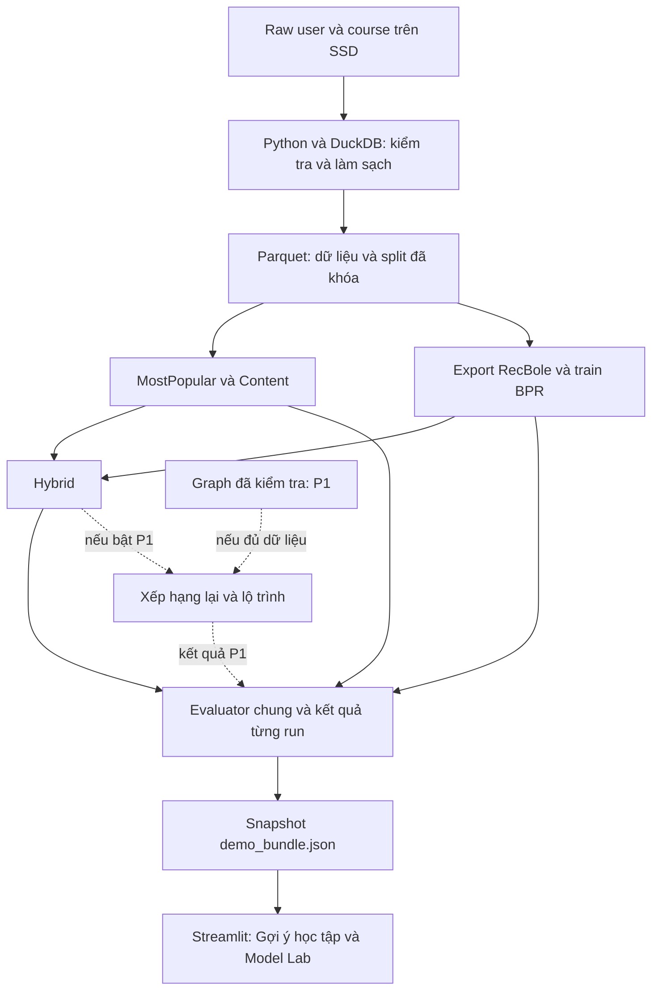

# 03 — Chia mã nguồn và ghép các phần

Cập nhật: 09/10/2026. Kiến trúc gồm phần đã xây và phần kế hoạch: `data/download.py`, `data/audit.py`, `demo/artifacts.py`, `cli.py` và `app/streamlit_app.py` đã chạy; prepare/split/model/evaluator/graph chưa xây. Hướng chung ở [trang bắt đầu](README.md), lệnh thật ở [runbook](09_runbook.md).

## 1. Ý tưởng đơn giản

Chia thành ba việc: **xử lý dữ liệu → tính/đánh giá gợi ý → hiển thị**. Mỗi phần nhận file đầu vào và tạo file đầu ra rõ ràng. Không cần API server/database riêng để hai phần model/UI cùng làm được.



Không có graph vẫn xuất được snapshot P0. Giao diện đọc kết quả có sẵn; click/chuyển tab không khởi động huấn luyện.

## 2. Công nghệ dùng vào việc gì?

| Công cụ | Vai trò |
| --- | --- |
| Python | Ngôn ngữ chung của xử lý, model, đánh giá và app |
| Parquet + DuckDB | File bảng chuẩn và công cụ lọc/thống kê; xem [lưu trữ](07_storage_analysis.md) |
| pandas / scikit-learn | Xử lý tập vừa bộ nhớ; TF-IDF tên/mô tả, profile lịch sử train và cosine cho Content |
| RecBole / PyTorch | Train BPR, lưu/load checkpoint qua adapter của dự án |
| NetworkX — P1 | Kiểm tra quan hệ concept và tạo thứ tự lộ trình trên graph đã lọc |
| Streamlit | Hai tab demo; lấy tinh thần thiết kế LearnPath |

Base Python/Streamlit/ijson và các thư viện dữ liệu đã cài trong môi trường riêng, có lock Windows Python 3.10 và [báo cáo kiểm tra](../results/base_verification.md). RecBole/PyTorch/graph chưa thử; khóa nhóm này sau spike BPR D04, benchmark BPR ở M6. Cài DuckDB/PyArrow chưa chứng minh đã có pipeline Parquet.

## 3. Các phần mã và trách nhiệm

Các đường dẫn trong bảng nằm dưới `src/recsysedu/`, trừ app.

| Phần | Đầu vào → đầu ra | Người nhận phần này làm gì? |
| --- | --- | --- |
| `data/audit.py` | Raw → thống kê/lỗi | Xác định format, ID, thời gian và quy mô dùng được |
| `data/prepare.py`, `data/split.py` | Raw → Parquet/split | Làm sạch theo tài liệu 04; chia theo tài liệu 05 |
| `models/popularity.py`, `models/content.py` | Train/catalog → điểm | Hai mô hình đầu tiên; profile chỉ từ train |
| `adapters/recbole.py` | Split → TSV/checkpoint/điểm | Nối RecBole với ID nguồn; kiểm tra số dòng và loại padding |
| `models/hybrid.py`, `recommend.py` | Điểm/history → ranking | Kết hợp điểm, loại khóa đã quan sát, fallback, lý do |
| `evaluation/metrics.py`, `evaluation/run.py` | Ranking/target → metric | Evaluator chung; lưu kết quả và manifest từng run |
| `knowledge/graph.py`, `knowledge/path.py` — P1 | Concept/edges → audit/path | Giữ chiều cạnh, báo unknown/vòng lặp, thứ tự concept |
| `demo/artifacts.py` | File kết quả → snapshot/đối tượng hiển thị | Xuất và kiểm tra contract model–UI; không chứa thuật toán train |
| `cli.py` | Tham số lệnh → bước pipeline | Một cách chạy lại các bước; không nhét thuật toán vào CLI |
| `app/streamlit_app.py` | Snapshot → hai tab | Quản lý lựa chọn user/model/khóa, hiển thị và thông báo lỗi |

## 4. Quy ước giữa model và UI

Model chấm danh sách khóa được truyền vào, trả `user_id`, `course_id`, `model_id`, `score_raw`, `run_id`. Adapter đổi ID số nội bộ RecBole về ID nguồn trước khi xuất.

Phần gợi ý nhận lịch sử được phép quan sát và tập khóa được chấm. Kết quả có rank, score, reason/evidence và fallback. Điểm bằng nhau phá hòa bằng course ID tăng dần; NaN/inf, ID lạ và khóa trùng bị chặn.

Sau đó xuất snapshot nhỏ `demo_bundle.json` chứa hồ sơ, catalog dùng cho demo, ranking và kết quả offline. [Tài liệu 04](04_data_contract.md) là nơi quy định tên trường/kiểu dữ liệu; [tài liệu 08](08_ui_handoff.md) quy định cách hiển thị. UI chỉ chọn/hiển thị, không tự tính lại ranking.

## 5. Hybrid và phần tiền đề

Chuẩn hóa điểm BPR và Content về cùng thang bằng min–max trên **cùng tập khóa của mỗi user/run**. Nếu toàn bộ điểm một thành phần bằng nhau, thành phần đó trở thành vector 0. Sau đó:

```text
hybrid = alpha * normalized_cf + (1 - alpha) * normalized_content
final  = hybrid - lambda * missing_exposure_ratio    # chỉ khi bật P1
```

`alpha` là mức ưu tiên BPR; `lambda` là mức trừ điểm khi chưa thấy tiếp xúc với tiền đề. Chọn chúng trên valid, khóa trước test. User không có embedding BPR dùng fallback rõ ràng; không tạo điểm CF ngẫu nhiên.

Course không ánh xạ graph có penalty 0 và trạng thái `unknown`. Course có mapping nhưng không thấy tiền đề có trạng thái `no_observed_prerequisite`. Cả hai chưa chứng minh người học đã đủ kiến thức. Cách tính trực tiếp/ancestor, chu trình và danh sách bị cắt ở [05](05_evaluation.md).

## 6. Cấu trúc thư mục dự kiến

```text
RecSysEdu/
├── docs/ và tasks/                 # Tài liệu hiện có
├── pyproject.toml, dependency lock # M0
├── configs/                        # Config dùng chung; đường dẫn local để riêng
├── src/recsysedu/                   # Các phần lõi ở bảng trên
├── app/streamlit_app.py             # Hai tab LearnPath
├── tests/fixtures/                  # Mẫu SYNTHETIC nhỏ, đưa vào Git
├── data/raw/                       # File gốc và manifest, ngoài Git
├── data/processed/<dataset_version>/ # Parquet, split và manifest, ngoài Git
├── data/recbole/                   # TSV export từ cùng split, ngoài Git
├── artifacts/<run_id>/             # Checkpoint, ID map và config, ngoài Git khi lớn
├── artifacts/demo/<snapshot_id>/   # demo_bundle.json và thông tin version
└── results/<run_id>/               # Metrics, logs, báo cáo phù hợp để bàn giao
```

Đường dẫn cụ thể do config quyết định; không ghi cứng `C:`/`D:` trong mã. CSV/JSON dành cho fixture và báo cáo nhỏ; Parquet là bảng processed chính. Khi cùng làm, nhận task theo module và ghép qua file đã thống nhất, theo [CONTRIBUTING](../CONTRIBUTING.md).
