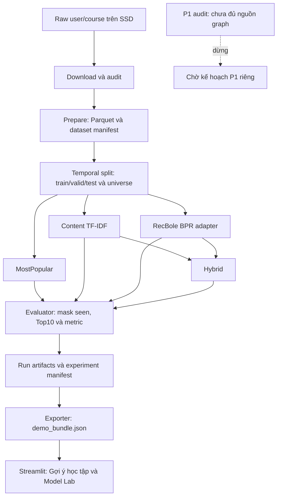

# 03 — Chia mã nguồn và ghép các phần

Cập nhật 16/10/2026. Đây là kiến trúc **đã triển khai và đã chạy P0 thật**:
prepare/split, bốn model, evaluator, runner, exporter và Streamlit. Kết quả ở
[test cuối](../results/final/report.md), [nghiệm thu](../reports/acceptance.md).
P1 chỉ có công cụ audit; graph thật chưa chạy, chưa có rerank/path.

## 1. Luồng đơn giản

Mỗi bước đọc file có phiên bản, kiểm hash rồi ghi output mới. Phần tính model
và phần hiển thị trao đổi qua file; không cần API server/database cho P0.



Giao diện chỉ đọc snapshot, không train hoặc tự chấm lại khi đổi hồ sơ/model.
Validation chọn BPR/alpha; test giữ nguyên checkpoint và feature đã khóa.

## 2. Module thực tế và trách nhiệm

Đường dẫn dưới `src/recsysedu/`, trừ app. Đây là module đã có, không phải cây dự kiến.

| Module | Đầu vào → đầu ra/trách nhiệm |
| --- | --- |
| `data/download.py`, `data/audit.py` | URL/raw → file gốc, manifest/hash, thống kê lỗi |
| `data/prepare.py` | Raw → courses/interactions/rejects/cohort Parquet và dataset manifest |
| `data/split.py` | Prepared → train/valid/test, warm cohorts, candidate universe, split manifest |
| `contracts.py` | `ScoreResult`, `RankedItem`, `RunIdentity`, giao diện `Recommender` |
| `models/popularity.py`, `models/content.py` | Train/catalog → enrollment counts hoặc TF-IDF/profile train-only |
| `adapters/recbole.py` | Export đúng split, train/load BPR, chuyển ID nội bộ về ID nguồn |
| `models/hybrid.py` | Ghép BPR/Content trên cùng candidate, chuẩn hóa và fallback |
| `evaluation/ranking.py`, `evaluation/metrics.py`, `evaluation/run.py` | Mask seen, phá hòa, Top-10, metric và artifact từng run |
| `experiments/runner.py` | Điều phối bốn model, chọn alpha bằng valid, kiểm freeze/hash trước test |
| `demo/export.py`, `demo/artifacts.py` | Export snapshot từ batch hoàn tất; kiểm schema/ID/hash/seen |
| `knowledge/audit.py` | Audit concept/mapping/label/cycle; chưa tạo graph phục vụ/rerank/path |
| `cli.py` | Lệnh chạy pipeline; không chứa thuật toán |
| `app/streamlit_app.py` | Snapshot → chọn hồ sơ/model, ranking, metadata và CSV |

Python/PyArrow tạo Parquet; DuckDB kiểm bảng; pandas/scikit-learn/SciPy xử lý
TF-IDF. RecBole 1.2.1/Torch 2.5.1+cpu đã chạy thật trên Windows/Python 3.10.11.
Lock và clean-environment evidence ở [reproduction](../results/reproduction.md).
Audit graph hiện dùng Python; không có module `knowledge/graph.py` hoặc
`knowledge/path.py` đang hoạt động.

## 3. Model không tự xếp Top10

Giao diện chung trong `contracts.py`:

```python
score(user_id, candidate_ids) -> ScoreResult(
    course_ids, scores, fallback_status, evidence
)
```

`course_ids` là tuple ID nguồn không trùng, theo **đúng thứ tự candidate đầu vào**;
`scores` là mảng NumPy 1 chiều cùng độ dài và hữu hạn. `fallback_status`
ghi cơ chế dự phòng; `evidence` ánh xạ course ID sang tuple câu bằng chứng.
Model chỉ chấm điểm. Evaluator giữ seen mask, phá hòa score giảm/course ID
tăng và lấy tối đa10. `RunIdentity` lưu run/model/dataset/split/protocol/seed
ở ranh giới run, không phải mỗi dòng score trả về.

Hybrid min–max hai score trên toàn universe của từng user **trước mask seen**:
`alpha * BPR + (1-alpha) * Content`. Thành phần hằng trở thành vector0.
Không áp dụng BPR thì fallback Content; Content/profile rỗng có popularity
fallback theo code và ghi nhãn. Alpha đã chọn0,25 bằng valid, không tune trên test.

## 4. File trên máy và file trong Git

```text
configs/                              # config versioned trong Git
src/recsysedu/, app/, tests/, docs/     # source/test/docs trong Git
data/raw/                             # raw + raw_manifest.json, ngoài Git
data/processed/mooccubex-pilot-v1/      # 4 Parquet + dataset_manifest.json
data/splits/mooccubex-pilot-v1-split-v1/ # 6 Parquet + split_manifest.json
results/local/pilot-final/valid/<batch>/
results/local/pilot-final/test/<batch>/
    artifacts/content/                # vectorizer, sparse features, manifest
    artifacts/bpr/                    # bpr.pth, ID map, bpr_manifest.json
    runs/<model>/                     # run_manifest, metrics.csv,
                                      # per_user_metrics.parquet, recommendations.jsonl
    snapshot_inputs/                  # input copies để exporter đọc batch di động
    experiment_manifest.json          # hash/inventory và nhận diện cả batch
artifacts/demo/v1/demo_bundle.json     # snapshot thật nhỏ, ngoài Git
results/pilot/, results/final/         # báo cáo tổng hợp nhỏ trong Git
```

Tên batch/test exact và hash ở final report. Validation có thể có alpha trials;
Hybrid chính có thể trỏ tới trial đã chọn. Atomic export khi train BPR nằm
`artifacts/atomic/recsysedu/recsysedu.<split>.inter` trong batch training;
test tái dùng model đã khóa nên không train/export lại.

Clone Git không có learner ID/checkpoint/ranking thật. Khi chuyển máy, giữ
nguyên cả batch và manifest; không chỉ chép `.pth` hoặc sửa hash/output_root.
[Runbook](09_runbook.md) liệt kê inventory và cách mở fixture/real snapshot.

## 5. P1 và đề xuất lịch sử

Thiết kế ban đầu từng đề xuất penalty tiền đề, NetworkX và learning path.
Đó là **ý tưởng lịch sử, chưa triển khai và không thuộc contract P0 hiện tại**.
`knowledge/audit.py` đã kiểm trên fixture nhưng thiếu cả ba nguồn graph thật;
quyết định là [P1_STOP_INSUFFICIENT_EVIDENCE](../results/graph_audit.md).
Muốn mở P1 cần dữ liệu/audit và plan riêng. Snapshot P0 luôn `paths=[]`,
trạng thái tiền đề `unknown`; không suy diễn enrollment thành mastery.

Tham khảo [contract](04_data_contract.md), [protocol](05_evaluation.md) và
[CONTRIBUTING](../CONTRIBUTING.md) trước khi đổi ranh giới module/file.
