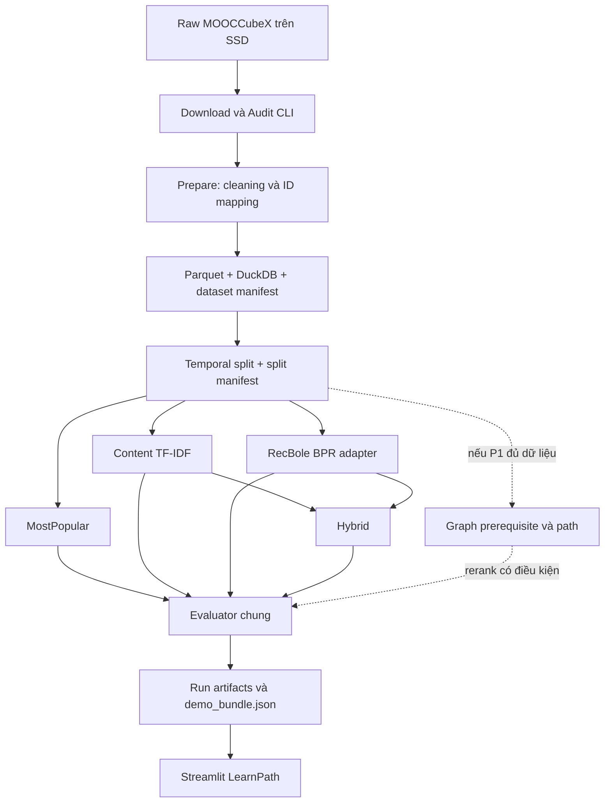

# Thiết kế RecSysEdu theo hướng Pipeline-first

Ngày: 16/10/2026
Trạng thái: **DRAFT — chờ người dùng duyệt trước khi lập implementation plan**

## 1. Tóm tắt dễ hiểu

RecSysEdu sẽ được làm như một đường ống có thể chạy lại:

```text
MOOCCubeX raw
  -> kiểm tra và làm sạch
  -> Parquet + manifest
  -> chia train/valid/test
  -> MostPopular, Content TF-IDF, BPR, Hybrid
  -> đánh giá chung
  -> demo_bundle.json
  -> Streamlit hiển thị kết quả
```

Mục tiêu của sáu tuần là chứng minh hệ thống có thể tạo Top-10 khóa học từ dữ liệu thật, so sánh bốn mô hình công bằng và bàn giao quy trình có thể chạy lại. Giao diện là nơi đọc kết quả đã tính, không huấn luyện mô hình khi người dùng bấm nút.

## 2. Bối cảnh và trạng thái hiện tại

### Đã có bằng chứng chạy

- Package Python, CLI, downloader và raw audit.
- Hai file MOOCCubeX `course.json` và `user.json`, tổng 851.441.849 byte, được lưu ngoài Git và có SHA-256 trong raw manifest.
- Audit toàn bộ hai file: 3.781 khóa, 3.330.294 người và 11.523.119 cặp user–course hợp lệ đã nối được catalog.
- Loader `demo_bundle.json`, fixture ghi nhãn `SYNTHETIC` và Streamlit hai tab.
- Bộ kiểm thử base, lint và kiểm dependency đã từng chạy; kết quả được ghi trong `results/base_verification.md`.

### Chưa có bằng chứng triển khai

- Chưa có `interactions.parquet`, dataset version hoặc split chính thức.
- Chưa có evaluator chạy trên dữ liệu thật.
- Chưa train MostPopular, Content TF-IDF, BPR hoặc Hybrid theo protocol chung.
- Chưa có checkpoint BPR, metric thật, ranking thật hoặc snapshot demo từ model thật.
- Chưa kiểm graph prerequisite; P1 chưa được bật.

Tài liệu thiết kế này không đổi các trạng thái trên thành “đã hoàn thành”.

## 3. Mục tiêu, người dùng và tiêu chí thành công

### Mục tiêu

1. Từ lịch sử đăng ký MOOCCubeX, tạo tối đa 10 khóa chưa được quan sát cho mỗi người học.
2. So sánh MostPopular, Content TF-IDF, BPR và Hybrid trên cùng dataset, cohort, candidate universe và quy tắc loại khóa đã thấy.
3. Giữ được nguồn gốc dữ liệu, config, seed, hash và kết quả của mỗi lần chạy.
4. Xuất một snapshot nhỏ để người khác mở demo mà không phải train lại.
5. Cho phép thành viên cùng làm qua GitHub bằng các module và file giao tiếp rõ ràng.

### Người dùng

- Thành viên nhóm chạy data/model/evaluation.
- Thành viên nhóm tích hợp và trình diễn Streamlit.
- Giảng viên hoặc người chấm xem phương pháp, metric và các trường hợp minh họa.

### Thành công của P0

P0 đạt khi:

- Có dataset và split versioned từ raw đã audit.
- Bốn mô hình tạo ranking bằng cùng protocol; checkpoint BPR load lại được.
- Có NDCG@10, HitRate@10/Recall@10, Precision@10 và Coverage@10 trên validation; test chỉ mở sau khi khóa cấu hình.
- Có `demo_bundle.json` chế độ `real`, loader kiểm được và Streamlit hiển thị ít nhất ba hồ sơ.
- Một người nhận dự án có thể cài môi trường, chạy pipeline hoặc mở snapshot theo runbook.
- Báo cáo phân biệt rõ dữ liệu thật, fixture giả, kết quả đo được và phần chưa hoàn thành.

## 4. Phạm vi

### P0 bắt buộc

- Raw acquisition, audit, cleaning, Parquet và DuckDB.
- Pilot 10.000 người đủ điều kiện; tăng tối đa khoảng 30.000 khi thời gian và tài nguyên đã được đo.
- Temporal split theo từng người dùng.
- MostPopular, Content TF-IDF, BPR và Hybrid.
- Evaluator chung, run manifest, metric và Top-K artifact.
- Snapshot thật và Streamlit tối thiểu.
- Kiểm thử, tái lập và tài liệu bàn giao.

### P1 có điều kiện

- Audit concept–course và graph prerequisite.
- Rerank theo tín hiệu tiền đề và path concept.
- Chỉ triển khai khi ID mapping, chiều cạnh, label, cycle và coverage đều có bằng chứng đủ dùng.
- Nếu không đạt, P0 vẫn được bàn giao và P1 được ghi `không đạt điều kiện dữ liệu`.

### Ngoài phạm vi sáu tuần

- Nhập toàn bộ 296 triệu hành vi vào PostgreSQL/MySQL.
- React, FastAPI và hệ thống web nhiều người dùng.
- Xử lý toàn bộ video, bài tập, bình luận hoặc session log.
- LightGCN, NeuMF, Transformer, contrastive learning hoặc LLM recommender.
- Khẳng định người học đã thành thạo, sẽ hoàn thành khóa hoặc học tốt hơn.

## 5. Kiến trúc mục tiêu



Thiết kế dùng file versioned làm ranh giới giữa các phần. Không cần API server hoặc database ứng dụng để hoàn thành P0.

## 6. Thành phần và trách nhiệm

| Thành phần | Trách nhiệm | Đầu vào | Đầu ra |
| --- | --- | --- | --- |
| Download/Audit | Tải an toàn, kiểm hash, đọc streaming, báo schema/lỗi | URL và raw config | Raw manifest, audit JSON/Markdown |
| Prepare | Chuẩn hóa ID, metadata, interaction; cách ly lỗi | Raw user/course | `interactions.parquet`, `courses.parquet`, rejects, dataset manifest |
| Split | Chọn cohort và tạo train/valid/test ổn định | Processed dataset | Split Parquet, cohort, split manifest |
| MostPopular | Tạo baseline theo số đăng ký train | Train và candidate universe | Score/ranking |
| Content | TF-IDF tên/mô tả; profile từ lịch sử train | Courses, train, config | Vectorizer, feature manifest, score/ranking |
| BPR adapter | Xuất RecBole, train/load checkpoint, đổi ID về ID nguồn | Split và config | Checkpoint, ID map, score/ranking |
| Hybrid | Chuẩn hóa và ghép Content/BPR | Hai score trên cùng candidate | Score/ranking Hybrid |
| Evaluator | Mask seen, xếp hạng, tính metric và lưu provenance | Score, target, protocol | Metrics, per-user metrics, recommendations, run manifest |
| Snapshot exporter/loader | Chuyển artifact thật sang contract UI và kiểm lỗi | Run artifacts | `demo_bundle.json` hợp lệ |
| Streamlit | Chọn hồ sơ/model và hiển thị dữ liệu có sẵn | Snapshot | Hai tab demo |
| Knowledge — P1 | Audit graph, rerank và path có nguồn | Concept/mapping/edges | Graph audit và P1 artifacts |

Mỗi thành phần chỉ thực hiện một trách nhiệm chính. CLI điều phối các thành phần nhưng không chứa thuật toán.

## 7. Luồng dữ liệu và quy tắc quan trọng

### 7.1 Raw và dữ liệu chuẩn

- Raw được giữ nguyên trên SSD/cloud, không commit vào Git.
- `course_order` dạng số chỉ đổi thành `C_<số>` khi ID đó tồn tại trong catalog.
- Tương tác có course lạ hoặc timestamp lỗi được cách ly; không tạo dữ liệu thay thế.
- Trùng `(user_id, course_id)` giữ timestamp hợp lệ sớm nhất và ghi số bản ghi đã gộp.
- Processed chính dùng Parquet. DuckDB dùng để truy vấn, thống kê và kiểm tra mà không phải nạp toàn bộ dữ liệu vào RAM.

Timestamp nguồn không có timezone. Trước khi phát hành split, nhóm phải chọn một trong hai bằng chứng có thể kiểm tra:

1. tìm được timezone từ nguồn chính thức; hoặc
2. ghi giả định versioned rằng timestamp được giữ ở dạng source-local/naive và chỉ dùng thứ tự tương đối trong cùng người dùng.

Không tự lấy timezone của máy chạy và không tuyên bố thời gian UTC khi chưa có nguồn.

### 7.2 Pilot và split

- Chọn người có ít nhất ba khóa hợp lệ khác nhau và ba mốc cuối tăng nghiêm ngặt.
- Lấy pilot 10.000 người bằng seed cố định từ tập đủ điều kiện; lưu cohort ID nội bộ và hash.
- Lượt cuối là test, áp chót là valid, phần trước là train.
- User có timestamp hòa tại ranh giới bị loại khỏi temporal cohort và được thống kê.
- Benchmark chính là warm-start: target phải có tín hiệu train trong dataset.
- Candidate universe gồm các khóa có tương tác train; mọi model dùng cùng universe.

Ở validation, profile/model chỉ dùng train và mask train. Ở test, model và profile vẫn giữ từ train; valid chỉ được thêm vào seen mask. Nếu sau này retrain bằng train+valid, đó là protocol mới và phải chạy lại mọi model.

### 7.3 Mô hình

- **MostPopular:** đếm từ train, loại khóa đã quan sát, phá hòa bằng `course_id` tăng dần.
- **Content:** TF-IDF từ `name + about`; thử char n-gram 2–4 trên validation. Profile là trung bình vector khóa train của user. Profile/vector rỗng dùng MostPopular và ghi fallback.
- **BPR:** dùng positive enrollment từ train, negative sampling trong train universe, lưu seed/config/checkpoint/ID map. Không diễn giải item âm là khóa người dùng không thích.
- **Hybrid:** min–max Content và BPR trên cùng candidate của từng user/run; `alpha` chọn trên validation. Nếu một score là hằng, thành phần chuẩn hóa thành vector 0. Nếu BPR không áp dụng cho user, dùng Content rồi MostPopular theo fallback đã khai báo.

### 7.4 Đánh giá

- K = 10; ưu tiên full ranking.
- NDCG@10 là chỉ số chính; báo thêm HitRate@10/Recall@10, Precision@10 và Coverage@10.
- Với một target/user, HitRate và Recall giống nhau; báo rõ để không tính như hai bằng chứng độc lập.
- Mọi model dùng cùng split, cohort, universe, seen mask và tie-break.
- Chỉ validation được dùng chọn cấu hình. Test mở sau khi dataset, protocol, seed và tham số đã khóa.
- Metric bằng 0 vẫn là kết quả hợp lệ. Không lọc lại cohort theo test để tăng điểm.

## 8. Contract giữa model và giao diện

Model không gọi trực tiếp UI. Phần giao tiếp duy nhất là snapshot `demo_bundle.json`:

- `meta`: schema, snapshot, dataset/split/protocol hash, `synthetic|real`, history mode.
- `users`: user ID và các khóa được phép hiển thị/dùng làm profile.
- `courses`: catalog nhỏ dùng cho lịch sử và ranking.
- `runs`: model, run ID, cohort, seed, config hash và metric status.
- `recommendations`: Top-K, rank, score, fallback, reason code và evidence.
- `paths`: để rỗng ở P0; chỉ mở schema khi P1 được nghiệm thu.

Loader phải chặn schema sai, ID lạ, hash không khớp, score không hữu hạn, rank trùng và khóa đã quan sát lọt vào Top-K. UI không tự đổi sang fixture nếu snapshot thật bị lỗi.

Streamlit chỉ cần hai nhóm chức năng:

1. **Gợi ý học tập:** chọn hồ sơ/model, xem lịch sử, Top-10, fallback và lý do có bằng chứng.
2. **Model Lab:** xem metric, cohort, split, seed, run ID và trạng thái `measured|not_available`.

## 9. Xử lý lỗi và khả năng chạy lại

- Mỗi bước fail nhanh với thông báo chứa file, record hoặc config liên quan; không âm thầm bỏ qua lỗi contract.
- Mọi lần chạy tạo `run_id` riêng; không ghi đè kết quả đã dùng trong báo cáo.
- Manifest lưu raw/dataset/split/config hash, seed, version thư viện, thời gian và Git revision hoặc trạng thái Git chưa có commit.
- Artifact lớn nằm ngoài Git; Git chỉ giữ code, config mẫu, fixture nhỏ, tài liệu và manifest không chứa dữ liệu nhạy cảm.
- Nếu thay cleaning/subset/split, tạo dataset version mới và chạy lại tất cả model cần so sánh.
- Nếu BPR không chạy trong budget, ưu tiên sửa môi trường và giảm số cấu hình; không đổi model khác rồi vẫn ghi BPR hoàn thành.
- Nếu P1 thiếu coverage hoặc có graph lỗi, giữ trạng thái unknown/không đạt và không tạo path thủ công để minh họa.

## 10. Chiến lược kiểm thử

### Unit test

- ID mapping, duplicate, timestamp lỗi/hòa và record không có catalog.
- Split không giao nhau, tăng thời gian nghiêm ngặt và tái lập theo seed.
- Seen mask, tie-break, Top-K ngắn và metric tính tay.
- TF-IDF profile rỗng, score hằng và fallback.
- Hybrid alpha 0/1 khớp từng thành phần.
- Snapshot schema, hash, rank, NaN/inf và ID tham chiếu.

### Integration test

- Fixture nhỏ chạy xuyên suốt prepare → split → bốn model → evaluate → snapshot.
- BPR checkpoint load lại tạo score trong tolerance đã định.
- CLI dùng config và tạo artifact ở đúng thư mục, không phụ thuộc ổ đĩa tuyệt đối.
- Streamlit đọc snapshot mới và đổi user/model mà không giữ cache sai.

### Kiểm tra dữ liệu thật

- Pilot 10.000 user tạo Parquet/split và manifest có số dòng/hash khớp.
- Bốn model dùng cùng protocol; evaluator từ cùng ranking tính ra bảng metric.
- Chọn 3–5 hồ sơ kiểm tra lịch sử, seen mask, Top-K, reason và fallback.
- Trước bàn giao, dựng môi trường sạch từ lock và chạy lại chuỗi tối thiểu.

## 11. Mốc sáu tuần và cổng quyết định

| Tuần | Trọng tâm | Cổng cuối tuần |
| --- | --- | --- |
| 1 | Timezone/giả định, prepare, pilot, split; thử tương thích BPR nhỏ | G1: dataset/split v1 có manifest |
| 2 | Evaluator, MostPopular và Content TF-IDF | G2: hai baseline cùng protocol |
| 3 | BPR, checkpoint và Hybrid | G3: bốn model chạy cùng protocol |
| 4 | Audit graph và P1 nếu đủ dữ liệu; nếu P0 chậm thì dùng tuần này sửa P0 | G4: quyết định P1 đạt hoặc dừng có lý do |
| 5 | Snapshot thật, Streamlit, khóa config và feature | G5: demo artifact thật; hết tính năng mới |
| 6 | Test cuối, phân tích, tái lập và bàn giao | G6: P0 có bằng chứng và runbook |

P0 được ưu tiên hơn P1. Khi trễ, giảm quy mô pilot, số cấu hình hoặc số seed trong budget đã ghi; không bỏ audit, protocol chung, seen mask hoặc evaluator.

## 12. Rủi ro và cách kiểm soát

| Rủi ro | Ảnh hưởng | Kiểm soát |
| --- | --- | --- |
| Timestamp không có timezone | Không thể tuyên bố thời gian tuyệt đối | Ghi nguồn hoặc giả định source-local versioned trước split |
| BPR/RecBole không tương thích Windows/Python | Chậm P0 | Spike nhỏ tuần 1, khóa dependency sau khi chạy được |
| Dữ liệu quá lớn | Tốn RAM/thời gian | Streaming raw, Parquet/DuckDB, pilot 10k rồi đo trước khi tăng |
| Metadata đa ngôn ngữ/thiếu field | Content yếu | Dùng name/about, thử char n-gram, báo coverage và fallback |
| Leakage hoặc model dùng candidate khác nhau | Metric không so sánh được | Một split manifest, evaluator và candidate policy chung |
| Hybrid không tốt hơn thành phần | Không đạt kỳ vọng trình diễn | Báo kết quả thật; mục tiêu là so sánh đúng, không ép Hybrid thắng |
| Graph thiếu hoặc lỗi | P1 không đáng tin | Cổng G4; tách trạng thái P1 khỏi nghiệm thu P0 |
| Git chưa có baseline | Khó cộng tác và truy vết | Chốt initial repository commit trước khi chia task triển khai |

## 13. Tổ chức cộng tác GitHub

- Một issue/task chỉ sở hữu một module hoặc artifact rõ ràng.
- Mọi thay đổi schema phải sửa đồng thời tài liệu contract, fixture, exporter và loader.
- Không commit raw, Parquet, checkpoint lớn, `.venv` hoặc báo cáo local chứa ID người học.
- PR ghi dữ liệu/fixture đã dùng, lệnh kiểm tra, kết quả và giới hạn.
- Chỉ tick task khi có artifact và lệnh nghiệm thu; “đã viết code” chưa đồng nghĩa “đã chạy dữ liệu thật”.
- Trước khi chia nhánh triển khai, tạo initial commit được nhóm xem lại để tránh mỗi người bắt đầu từ một tree khác nhau.

## 14. Điều kiện đổi thiết kế

Tạo ADR mới hoặc cập nhật ADR hiện có nếu xảy ra một trong các trường hợp:

- Giảng viên bắt buộc tài nguyên ngoài khóa học hoặc yêu cầu mô hình khác.
- Enrollment sau cleaning không đủ tạo cohort có ý nghĩa.
- Nhóm cần web online thật, authentication hoặc nhiều người dùng đồng thời.
- P1 graph đạt coverage đủ và được đưa vào phạm vi bàn giao chính.
- Protocol chuyển từ per-user temporal sang global-time hoặc train+valid retraining.

Khi đổi dataset hoặc protocol, metric cũ và mới phải ở bảng riêng; không ghép chúng như cùng một thí nghiệm.

## 15. Quyết định cần người dùng duyệt

Design spec đề xuất chốt:

1. P0 là bốn model và pipeline offline; P1 graph có điều kiện.
2. Pilot bắt đầu từ 10.000 user đủ điều kiện, chỉ tăng sau khi đo tài nguyên.
3. Parquet + DuckDB là processed layer; Streamlit đọc snapshot, chưa dùng FastAPI/PostgreSQL/React.
4. Validation chọn tham số; test chỉ mở sau khi khóa cấu hình.
5. Hết tuần 3 mà P0 chưa ổn thì dùng tuần 4 cho P0 và dừng P1.

Sau khi tài liệu này được duyệt, bước tiếp theo duy nhất là viết implementation plan chi tiết bằng quy trình Superpowers `writing-plans`. Chưa triển khai product code ở giai đoạn duyệt spec.

## Tài liệu liên quan

- [Hướng đồ án theo môn học](../../10_course_direction.md)
- [Kiến trúc hiện có](../../03_architecture.md)
- [Data contract](../../04_data_contract.md)
- [Protocol đánh giá](../../05_evaluation.md)
- [Kế hoạch kỹ thuật hiện có](../../../tasks/plan.md)
- [Lịch sáu tuần hiện có](../../../tasks/six_week_schedule.md)
- [Audit dữ liệu thật](../../../results/data_audit.md)
- [Báo cáo base](../../../results/base_verification.md)
