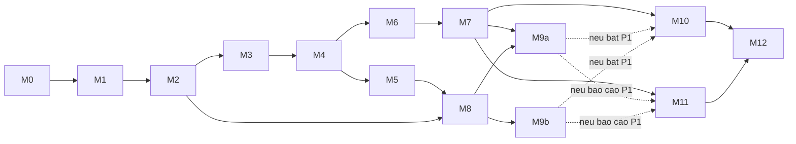

# Kế hoạch triển khai RecSysEdu

Ngày: 09/10/2026. **Đã triển khai base, kế hoạch toàn dự án chưa hoàn thành.** Package/CLI tải và audit, fixture/loader, app hai tab đã chạy. M0/M1 còn điều kiện chưa đạt; xem [todo](todo.md). Lệnh download/audit/demo validate chạy được theo [runbook](../docs/09_runbook.md); prepare/split/train/evaluate/graph bên dưới vẫn là giao diện dự kiến.

**Yêu cầu lịch mới:** tổ chức khối lượng dự án khoảng ba tháng để hoàn thành trong sáu tuần. [Lịch chi tiết 30 ngày làm việc](six_week_schedule.md) là lịch thực hiện hiện hành; tài liệu này giữ tiêu chí kỹ thuật từng M-task. Lịch không phụ thuộc giả định số thành viên. Phát triển chỉ đánh giá validation; test chính thức sau khi khóa cấu hình ở D25.

**Điều chỉnh theo môn học:** căn cứ ở [10](../docs/10_course_direction.md), [11](../docs/11_course_reading_notes.md) và [ADR-002](../docs/decisions/ADR-002-course-grounded-direction.md). M4 dùng TF-IDF tên/mô tả thay field-only; hiện chỉ phân tích chức năng hiển thị, chưa phát triển thêm UI. Data/evaluator/model đi trước M10.

## Mục tiêu và thứ tự

Tạo một đường chạy từ raw tới recommendation và bảng đánh giá trước khi phát triển graph/demo. Mỗi task kết thúc bằng artifact có thể xem, một cách kiểm tra và điều kiện chuyển tiếp. Không đánh dấu task xong chỉ vì đã viết code.

M5 là mở rộng feature concept, không chặn BPR nếu Content văn bản đã đủ chạy. M8–M9b là nhánh graph. M11 hoàn thiện thí nghiệm để M12 tái lập bản cuối. Sơ đồ là quan hệ công việc, không phải yêu cầu dùng agent song song.

Trong lịch sáu tuần, phần audit mapping của M5 cần cho M8; phần thêm concept vào Content có thể hoãn. Spike môi trường của M6 được thử sớm D04 sau fixture M0, còn benchmark/evaluator BPR vẫn cần M2–M4. Đây là việc phát hiện lỗi sớm, không vượt qua phụ thuộc của benchmark.

Thiết kế áp dụng: [requirements](../docs/02_requirements.md), [data contract](../docs/04_data_contract.md), [protocol](../docs/05_evaluation.md), [ADR](../docs/decisions/ADR-001-scope-stack.md). Mỗi task dự kiến chạm 2–5 file chính; fixture/config/báo cáo chỉ bổ sung trong phạm vi task đó.

## M0 Chuẩn bị môi trường và fixture nhỏ

**Phụ thuộc:** Rà soát thiết kế và protocol trước khi code. **Quy mô:** M.

Xây package Python, CLI help, dependency groups `dev/cf/demo/graph` và fixture SYNTHETIC. Thử môi trường lõi trên máy thực thi; cf chỉ khóa sau spike M6.

Schema snapshot UI và fixture SYNTHETIC đã có để kiểm đầu ra. Hiện không tiếp tục dựng bố cục; fixture không thay kiểm tra lỗi dữ liệu/protocol. Processed chính dùng Parquet; CSV/JSON dành cho fixture và báo cáo nhỏ.

**File chính:** `pyproject.toml`, `.gitignore`, `src/recsysedu/cli.py`, `tests/fixtures/manifest.json`, `tests/test_cli.py`.

**Đầu ra:** Package cài được, CLI help, fixture có provenance, báo cáo môi trường. Không phát sinh kết quả MOOCCubeX ở task này.

**Nghiệm thu:**

- Package import và CLI help hoạt động trong môi trường riêng.
- Fixture bao phủ lỗi ID/thời gian/mảng lệch, target cold, tie và graph cycle.
- Version môi trường và hướng dẫn PowerShell được ghi; dữ liệu lớn, secrets và cache được ignore.

**Kiểm tra dự kiến:** `python -m recsysedu.cli --help`; `python -m pytest tests/test_cli.py`.

**Chuyển bước:** Lõi cài được trên máy mục tiêu. Git init nếu nhóm muốn quản lý phiên bản; chưa gắn remote/đẩy dữ liệu ở task này.

## M1 Audit raw và khả năng dùng dữ liệu

**Phụ thuộc:** M0. **Quy mô:** M.

Tải tối thiểu user/course theo link nguồn; ghi checksum và kiểm tra format trước parser. Audit toàn catalog và mật độ lịch sử trước lọc domain/subset. Không cần video/problem logs.

**File chính:** `src/recsysedu/data/audit.py`, `configs/data.yaml`, `tests/test_audit.py`, `results/data_audit.md`.

**Đầu ra:** Raw manifest, schema sample đã giảm thông tin cá nhân, data audit JSON/Markdown.

**Nghiệm thu:**

- Xác định JSON Lines/array, timezone, length mismatch, valid timestamp, unknown course và duplicates.
- Báo số user đủ lịch sử, phân bố số khóa/user và độ phủ field; số lượng trước/sau lọc.
- Có đề xuất subset dựa vào số đo; trường hợp không đủ dữ liệu được ghi là chưa đủ.

**Kiểm tra dự kiến:** `python -m recsysedu.cli data audit --config configs/data.yaml`; `python -m pytest tests/test_audit.py`.

**Chuyển bước:** Parser/timezone đã xác định, raw có manifest. Nếu không tải được hoặc data không đủ, xử lý phạm vi trước khi bắt đầu train.

## M2 Chuẩn hóa và đóng băng split

**Phụ thuộc:** M1. **Quy mô:** M.

Sinh interactions/catalog, rejects, split và cohort theo contract. Config dữ liệu thực được ghi lại sau audit; không cố đạt con số subset minh họa.

**File chính:** `src/recsysedu/data/prepare.py`, `src/recsysedu/data/split.py`, `tests/test_prepare.py`, `tests/test_split.py`, `configs/split.yaml`.

**Đầu ra:** Processed dataset, train/valid/test, warm/cold cohort, split manifest.

**Nghiệm thu:**

- Không có ID mồ côi/duplicate; không zip mảng lệch; rejects có lý do và thống kê.
- Không giao nhau `(user,course)`; thứ tự train < valid < test theo user đủ điều kiện; tie tại ranh giới không bị bịa thứ tự.
- Hash, cohort và seed cố định; chạy lại cho cùng đầu vào có cùng nội dung output.

**Kiểm tra dự kiến:** `python -m recsysedu.cli data prepare --config configs/data.yaml`; `python -m recsysedu.cli data split --config configs/split.yaml`; `python -m pytest tests/test_prepare.py tests/test_split.py`.

**Checkpoint A:** Dataset hợp lệ và protocol có thể đọc lại; chưa có metric model thật.

## M3 MostPopular và evaluator chung

**Phụ thuộc:** M2. **Quy mô:** M.

Hoàn thành lát cắt đầu tiên: train → score → seen mask → Top-K → metric. Popularity chỉ đếm train.

**File chính:** `src/recsysedu/models/popularity.py`, `src/recsysedu/evaluation/metrics.py`, `src/recsysedu/evaluation/run.py`, `tests/test_evaluation.py`, `configs/popularity.yaml`.

**Đầu ra:** Baseline run manifest, metric, per-user ranking và tối thiểu ba ví dụ recommendation.

**Nghiệm thu:**

- Không đưa seen course/padding/duplicate vào Top-K; test target không bị mask.
- Metric đúng trên ví dụ tính tay: target rank 1, rank 2, miss, danh sách ngắn; Recall=Hit khi một target.
- Chạy được dữ liệu thật đã phát hành M2; metric zero vẫn được ghi trung thực.

**Kiểm tra dự kiến:** `python -m pytest tests/test_evaluation.py`; `python -m recsysedu.cli evaluate --model popularity --config configs/popularity.yaml`.

**Chuyển bước:** Pipeline có một kết quả thật tái lập được; metric được kiểm tra độc lập trước thêm model.

## M4 Content-based TF-IDF từ tên/mô tả

**Phụ thuộc:** M3. **Quy mô:** M.

Chuẩn hóa name/about, tạo TF-IDF; thử char n-gram 2–4 trên bản nhiều tiếng Trung, fit vocabulary/IDF trên metadata universe train. Profile là trung bình vector course train của user; dùng cosine. Field bổ sung nếu có, không điền nhãn giả. Fallback cho profile/feature rỗng được khai báo rõ. Đây là cấu hình thử, chưa chứng minh tối ưu.

**File chính:** `src/recsysedu/models/content.py`, `src/recsysedu/recommend.py`, `tests/test_content.py`, `configs/content.yaml`.

**Đầu ra:** Vectorizer/feature artifact có version/hash, bảng so sánh với popularity, reason có khóa lịch sử tương đồng và evidence được tính; field chung chỉ nêu khi có thật.

**Nghiệm thu:**

- Profile chỉ dùng train; score hữu hạn, tie-break ổn định và fallback có reason code.
- Metadata cleaning/fit scope/ngôn ngữ rõ; số vector/profile rỗng được báo; không học feature từ target history.
- Dùng đúng cohort/candidate/seen policy M3.
- Có ví dụ profile khác nhau tạo score/ranking khác nhau khi feature cho phép; không hứa mọi user phải khác.

**Kiểm tra dự kiến:** `python -m pytest tests/test_content.py`; `python -m recsysedu.cli evaluate --model content --config configs/content.yaml`.

**Checkpoint B:** Popularity và Content cùng benchmark, pipeline không dùng target làm feature.

## M5 Bổ sung feature concept nếu độ phủ đủ

**Phụ thuộc:** M4. **Quy mô:** S/M. **Có thể hoãn.**

Audit concept–course và thêm feature concept nếu còn budget, giữ Content text-only M4 để ablation. Coverage thấp thì giữ text-only. Field-only chỉ thử phụ khi mapping đã xác minh, không là mô hình chính bắt buộc.

**File chính:** `src/recsysedu/data/concepts.py`, `src/recsysedu/models/content.py`, `tests/test_concepts.py`, `configs/content_concept.yaml`.

**Đầu ra:** Mapping audit, feature artifact và so sánh text-only/text+concept khi thực sự triển khai.

**Nghiệm thu:**

- Kiểm tra đúng thứ tự cột, ID, duplicates và số course không có concept.
- Không dùng lịch sử valid/test để tạo exposure/profile.
- Feature version và mapping hash trong manifest; không ghi coverage giả cho course thiếu mapping.

**Kiểm tra dự kiến:** `python -m pytest tests/test_concepts.py`; `python -m recsysedu.cli evaluate --model content --config configs/content_concept.yaml`.

**Chuyển bước:** Chọn phiên bản content theo validation và lưu version; M6 không bị chặn nếu task này hoãn.

## M6 Adapter RecBole và BPR

**Phụ thuộc:** M3–M4. **Quy mô:** M; bắt đầu bằng spike fixture.

Kiểm tra dependency tương thích Windows/thiết bị trên fixture: import → load pre-split → train ngắn → checkpoint reload → score gốc. Sau đó mới chạy subset thật và khóa cf dependency.

**File chính:** `src/recsysedu/adapters/recbole.py`, `configs/bpr.yaml`, `tests/test_recbole_adapter.py`, `results/bpr_environment.md`.

**Đầu ra:** Atomic files, ID map, lock/runtime report, BPR checkpoint và score artifact.

**Nghiệm thu:**

- Loader giữ đúng số dòng pre-split; round-trip ID không mất khóa, không trả padding.
- Fit chỉ train; sampler được ghi; checkpoint reload cho cùng score trong tolerance số học.
- Evaluator chung dùng cùng cohort/universe/mask; so metric RecBole khi cấu hình tương đương.

**Kiểm tra dự kiến:** `python -m pytest tests/test_recbole_adapter.py`; `python -m recsysedu.cli train --model bpr --config configs/bpr.yaml`; `python -m recsysedu.cli evaluate --model bpr --config configs/bpr.yaml`.

**Chuyển bước:** BPR chạy thật và load được. Nếu spike thất bại, báo lỗi/tương thích; không tự thay BPR bằng model khác rồi vẫn đánh dấu M6 xong.

## M7 Hybrid và tuning validation

**Phụ thuộc:** M4, M6. **Quy mô:** M.

Chuẩn hóa score trên cùng candidate list, tune alpha bằng validation rồi khóa config. Benchmark chấm full universe, không chỉ union candidate demo.

**File chính:** `src/recsysedu/models/hybrid.py`, `src/recsysedu/evaluation/tune.py`, `tests/test_hybrid.py`, `configs/hybrid.yaml`.

**Đầu ra:** Validation search log, resolved alpha, bảng so sánh validation. Test chính thức thực hiện ở M11 sau khóa cấu hình D25.

**Nghiệm thu:**

- Alpha=0/1 trả đúng thành phần chuẩn hóa; score hằng/thiếu CF được xử lý rõ.
- Test không được dùng để chọn alpha/model/content version.
- Dataset/split/protocol khớp; công bố cả trường hợp Hybrid không cải thiện.

**Kiểm tra dự kiến:** `python -m pytest tests/test_hybrid.py`; `python -m recsysedu.cli tune --model hybrid --config configs/hybrid.yaml`; `python -m recsysedu.cli evaluate --model hybrid --config configs/hybrid.yaml`.

**Checkpoint C:** Có đường chạy bốn model và bảng so sánh trung thực. Graph/demo chỉ bắt đầu sau baseline ổn định.

## M8 Audit graph prerequisite

**Phụ thuộc:** M2 và mapping concept được audit theo M5; không bắt buộc dùng concept làm feature. **Quy mô:** M.

Đọc prerequisite CS, xác nhận join ID và chiều cạnh. Tách nhãn 1/0/unknown, self-loop, duplicates, cycle. Không tự sửa graph mà không lưu provenance.

**File chính:** `src/recsysedu/knowledge/graph.py`, `tests/test_graph.py`, `configs/graph.yaml`, `results/graph_audit.md`.

**Đầu ra:** Graph artifact, mapping/label/cycle/coverage audit.

**Nghiệm thu:**

- Cạnh A→B đúng nghĩa A cần trước; label 0/-1 không lọt vào graph hoạt động.
- Có báo cáo ID không nối, self-loop, SCC/cycle và coverage trên catalog benchmark.
- Chỉ phát hành phần dùng được; vùng có cycle giữ trạng thái để chặn path.

**Kiểm tra dự kiến:** `python -m pytest tests/test_graph.py`; `python -m recsysedu.cli graph audit --config configs/graph.yaml`.

**Chuyển bước:** Có graph dùng được và biết phạm vi độ phủ; nếu không đủ, ghi phần graph chưa hoàn thành và giữ sản phẩm core.

## M9a Rerank theo prerequisite

**Phụ thuộc:** M7, M8. **Quy mô:** S/M.

Tính direct missing-exposure ratio, soft penalty và tune lambda bằng valid. Cùng graph cohort cho bảng có/không penalty.

**File chính:** `src/recsysedu/knowledge/rerank.py`, `tests/test_rerank.py`, `configs/prerequisite.yaml`.

**Đầu ra:** Score thành phần, validation lambda log, ranking/graph metrics.

**Nghiệm thu:**

- Lambda=0 khôi phục Hybrid; unknown không bị gọi là mastered.
- Exposure từ train; không loại hard course chưa có prerequisite exposure.
- Báo ranking trade-off và graph coverage; không coi missing ratio là learning gain.

**Kiểm tra dự kiến:** `python -m pytest tests/test_rerank.py`; `python -m recsysedu.cli tune --model prerequisite --config configs/prerequisite.yaml`; `python -m recsysedu.cli evaluate --model prerequisite --config configs/prerequisite.yaml`.

**Chuyển bước:** Penalty kiểm chứng được, dù không cải thiện NDCG.

## M9b Learning path theo concept

**Phụ thuộc:** M8; có thể thực hiện sau M9a để giữ tiến độ đơn giản. **Quy mô:** M.

Lấy ancestor của concept mục tiêu, sắp thứ tự topo và gắn course tham khảo. Trả trạng thái explicit cho unknown/cycle/truncated.

**File chính:** `src/recsysedu/knowledge/path.py`, `tests/test_path.py`, `results/path_cases.md`.

**Đầu ra:** Path artifact và 3–5 case có cạnh nguồn được trích.

**Nghiệm thu:**

- Đúng thứ tự A→B→C trên fixture; không khẳng định mastery hoặc course prerequisite ground truth.
- Graph cycle trả lỗi có lý do; path >20 concept trả truncated, không gọi đầy đủ.
- Case thật gắn provenance; thiếu mapping có trạng thái unknown.

**Kiểm tra dự kiến:** `python -m pytest tests/test_path.py`; `python -m recsysedu.cli path --config configs/graph.yaml --user USER_ID --target COURSE_ID`.

`USER_ID/COURSE_ID` là chỗ thay bằng ID thật trong artifact, không phải bản ghi mẫu đã xác nhận.

**Checkpoint D:** Có graph được audit, rerank được đo và path có giới hạn rõ.

## M10 Demo đọc artifact

**Phụ thuộc:** Tích hợp thật cần M7; thêm M9a/M9b nếu demo graph. Bố cục trên fixture có thể làm sau M0. **Quy mô:** M.

Demo tối thiểu có hai nhóm chức năng: Gợi ý học tập (lịch sử/Top-10/reason/path nếu đủ graph) và kết quả thí nghiệm (metric/run metadata). Đọc snapshot theo [quy ước file UI, mục 6](../docs/04_data_contract.md); thông tin/điều kiện/nghiệm thu ở [08](../docs/08_ui_handoff.md). Base đã có mẫu; chưa dành tuần 1–4 cho phát triển thêm UI. Tuần 5 mới tích hợp thật/nghiệm thu, không train khi click.

**File chính:** `app/streamlit_app.py`, `src/recsysedu/demo/artifacts.py`, `tests/test_demo_artifacts.py`, `configs/demo.yaml`.

**Đầu ra:** Demo local đọc snapshot đã xuất, Model Lab và hướng dẫn lấy artifact/chạy; người nhận demo không bắt buộc train lại.

**Nghiệm thu:**

- Tối thiểu ba profile; không dùng phần trăm score như xác suất; có fallback cho user mới.
- Artifact mismatch bị chặn; đổi profile/model không dùng lại kết quả cache sai.
- Chế độ offline/demo được ghi; unknown/cycle/path ngắn hiện rõ khi graph bật.
- Model Lab có run ID, dataset/split/cohort/candidate policy; không trộn protocol hoặc dùng số mẫu làm metric thật.

**Kiểm tra dự kiến:** `python -m pytest tests/test_demo_artifacts.py`; `python -m streamlit run app/streamlit_app.py`. Kiểm tra trình duyệt với ba profile, profile mới, artifact lỗi và đổi model.

**Chuyển bước:** Demo thật đọc model/result artifact, không mock kết quả dưới nhãn dự đoán thật.

## M11 Thực nghiệm cuối và phân tích sai số

**Phụ thuộc:** M7, thêm M9a/M9b cho RQ3. **Quy mô:** M.

Chạy protocol đã khóa, seeds theo budget, E1–E4; E5 chỉ nếu tối ưu demo. Lưu nhóm ít/nhiều lịch sử và case thất bại.

**File chính:** `configs/experiments.yaml`, `src/recsysedu/evaluation/report.py`, `results/experiment_report.md`, `results/path_cases.md`.

**Đầu ra:** Metrics CSV, per-user metrics, mean/std nếu multi-seed, biểu đồ/bảng và giải thích kết quả.

**Nghiệm thu:**

- Mọi hàng kết quả có run manifest và cùng protocol nếu đặt chung bảng.
- Cỡ nhóm, cold targets, graph unknown và failure cases được báo cáo.
- Không có số liệu minh họa được dùng làm metric; RQ chưa có bằng chứng ghi rõ chưa trả lời.

**Kiểm tra dự kiến:** `python -m recsysedu.cli experiments --config configs/experiments.yaml`; đối chiếu một số user với ranking/target và log nguồn.

**Chuyển bước:** Kết luận bám đúng số đo, không buộc có cải thiện.

## M12 Tái lập và bàn giao

**Phụ thuộc:** M10, M11. **Quy mô:** S/M.

Chạy lại trong môi trường sạch, hoàn thiện README, báo cáo và runbook. Nếu thiếu graph, bàn giao core với trạng thái thiếu rõ ràng thay vì nhận đủ phạm vi nâng cao.

**File chính:** `README.md`, `docs/runbook.md`, dependency lock, `results/reproduction.md`.

**Đầu ra:** Hướng dẫn thật có lệnh chạy được, kết quả tái lập, demo, báo cáo đồ án; slides/video nếu nhóm yêu cầu.

**Nghiệm thu:**

- Môi trường sạch import/train/load/evaluate/demo được; test phù hợp đều pass.
- Metric tái lập trong tolerance đã định và lý do sai khác thiết bị/seed được ghi.
- README phản ánh trạng thái thực; dữ liệu, license upstream và artifact công bố được kiểm tra theo phạm vi phân phối thực tế.

**Kiểm tra dự kiến:** `python -m pytest`; chạy lại runbook từ raw có checksum; kiểm tra demo trên artifact vừa tái lập.

**Checkpoint E:** Nghiệm thu theo FR/EX/NFR, báo riêng phần đã chạy, phần thiết kế và phần chưa có bằng chứng.

## Lịch sáu tuần tham khảo

Chi tiết công việc từng ngày, artifact và nghiệm thu xem [lịch sáu tuần](six_week_schedule.md). Tóm tắt dưới đây được cập nhật theo yêu cầu hoàn thành trong sáu tuần.

| Tuần | Công việc | Điều kiện cuối tuần |
| --- | --- | --- |
| 1 | M0–M2; spike môi trường M6 | Data audit, split hợp lệ và lỗi tương thích được phát hiện sớm |
| 2 | M3–M4 | Hai baseline có bảng validation |
| 3 | M6–M7 | BPR load được, Hybrid tune validation |
| 4 | Audit mapping M5, M8–M9b | Graph/path có provenance hoặc báo thiếu dữ liệu |
| 5 | M10 và chuẩn bị M11 | Demo, case study và khóa cấu hình cuối |
| 6 | M11–M12 và hoàn thiện báo cáo | Test chính thức, chạy lại được, kết luận đúng bằng chứng |

Đây là lịch mục tiêu với nghiệm thu, chưa phải cam kết công sức đã xác nhận. Khi chậm, giảm phần feature concept/LightGCN/video/bài tập trước; không bỏ audit hoặc evaluator. Ngày bắt đầu và năng lực thực hiện chưa được xác định; không đưa số người thành giả định cố định.

## Rủi ro và điều kiện thay đổi kế hoạch

Nếu M1 không có đủ enrollment hợp lệ, điều chỉnh subset/domain và mục tiêu với bằng chứng. Nếu M6 lỗi tương thích, giữ baseline đang chạy và giải quyết môi trường trước khi nhận BPR hoàn thành. Nếu M8 thiếu coverage, tách core và graph status. Nếu muốn production hoặc đo learning gain, đó là phạm vi mới cần thiết kế riêng.
